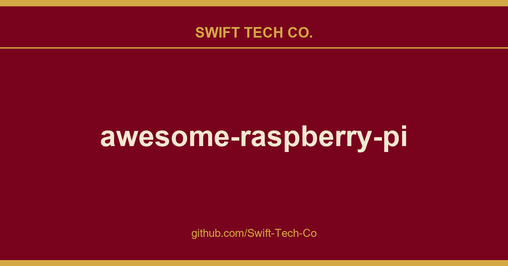

# awesome-raspberry-pi

## What This Is

This is part of the Swift Tech Co. working stack for product and engineering. It gathers the awesome-raspberry-pi notes, examples and fixes that keep delivery fast, and doubles as the reference map we hand to whoever picks up this thread next.

## Images

## Contents

- [Models](#models)
- [OS Images](#os-images)
- [Tools](#tools)
- [Projects](#projects)
- [Resources](#resources)

## Models

The complete collection of (consumer) Raspberry Pi models consist of:

- Raspberry Pi 1, Model A & Model B (2012, discontinued)
- Raspberry Pi 1, Model B+ (July, 2014)
- Raspberry Pi 1, Model A+ (November, 2014)
- Raspberry Pi 2, Model B (February, 2015)
- Raspberry Pi Zero (November, 2015)
- Raspberry Pi 3, Model B (March, 2016)
- Raspberry Pi Zero W (February, 2017)
- Raspberry Pi 3, Model B+ (March, 2018)
- Raspberry Pi 3, Model A+ (November, 2018)
- Raspberry Pi 4, Model B (June, 2019)
- Raspberry Pi 5 (October, 2023)
- Raspberry Pi 400 (November, 2020)
- Raspberry Pi 500 (December, 2024)
- Raspberry Pi 500+ (September, 2025)
- Raspberry Pi Pico (January, 2021)
- Raspberry Pi Pico 2 (August, 2024)
- Raspberry Pi Zero 2 W (October, 2021)
- Raspberry Pi Pico W (June, 2022)

## OS Images

- Alpine Linux - Security-oriented, lightweight Linux distribution based on musl libc and busybox.
- Anthias - The world's most popular open source digital signage project.
- Arch Linux ARM - Lightweight and flexible Linux distribution that tries to Keep It Simple.
- Armbian - A base operating system platform for single board computers (SBCs) that other projects can trust to build upon.
- balenaOS - open source OS to run Docker containers on embedded devices that's been designed for reliability and proven in production.
- BerryBoot - Bootloader/universal OS installer, with support to VNC and HDMI-CEC.
- chilipie-kiosk - Image which boots directly into full-screen Chrome, perfect for dashboards and build monitors. 
- Channels DVR Server - Custom image for Channels DVR Server which provides a whole home DVR system.
- DietPi - Minimal image designed to fit on a 2GB SD card, with tons of configurable settings and scripts.
- DroneBridge - A WifiBroadcast extension to make for a real alternative to DJI Lightbridge and other similar systems. 
- EZ-WifiBroadcast - Affordable Wireless Digital HD Video Transmission made easy.  
- Fedora - Linux Fedora distribution built for the Pi. 
- FreeBSD - FreeBSD is an advanced computer operating system used to power modern servers, desktops, and embedded platforms.
- FreedomBox - FreedomBox is a private home server for non-experts. 
- Gentoo - Gentoo Stage 3 tarball for Raspberry Pi.
- Gladys Assistant - Gladys, a privacy-first, open-source home assistant. 
- GlowBarn OS - Buildroot-based Linux distribution for paranormal research with EMF sensors, environmental monitoring, web dashboard and automated data logging. 
- HamPi - Formerly known as W3DJS Raspberry Pi for Ham Radio.
- Hass.io - Home automation operating system/application for embedded device, also available standalone.
- HypriotOS - Minimal Debian-based operating system, optimized to run Docker.
- Kali Linux - Penetration Testing & Ethical Hacking Linux distro for ARM devices.
- KonstaKANG - Unofficial LineageOS and AOSP builds for Raspberry Pi. 
- Lakka - Retro-gaming on the Raspberry Pi built entirely on RetroArch.
- LibreELEC - Just enough OS for Kodi
- Mainsail OS - A distribution for 3D Printers that includes everything to get started with Klipper Firmware and Mainsail.
- Manjaro - Friendly, open-source Linux distribution for Raspberry Pi.
- Minibian - Minimal Raspbian (lighter than Jessie Lite).
- moOde - The moOde audio player acts as an Audiophile streamer with DLNS, Spotify Connect and AirPlay support for old receivers.  
- MoodleBox - The MoodleBox provides a Moodle learning management system on Raspberry Pi. 
- motionEyeOS - Linux distribution that turns a single-board computer into a video surveillance system.
- NetBSD - NetBSD is a free, fast, secure, and highly portable Unix-like Open Source operating system.
- NextCloudPi - Nextcloud ready image based on Raspbian. Features Nextcloud 11 running on Raspbian 8, with PHP 7 and HTTP2 enabled Apache server.
- NOOBS - New Out Of the Box Software, an easy OS installer for beginners.
- OctoPi - Distribution for 3d printers.
- OpenHABian - A preconfigured version of the OpenHAB home automation software. 
- OpenMediaVault - OpenMediaVault is the next generation network attached storage (NAS) solution based on Debian Linux containing services like SSH, (S)FTP, SMB/CIFS, DAAP media server, RSync, BitTorrent client and many more. 
- openSUSE - openSUSE is a major Linux distribution that has images based for its stable release Leap and rolling release Tumbleweed. Images can be found for many of the Pis, including the Raspberry Pi 3 and Raspberry Pi 4.
- OpenWRT - OpenWrt is described as a Linux distribution for embedded devices for network management.
- OSMC - Open Source Media Centre, based on Kodi.
- PiDeck - Small form factor DVS system allowing you to control digital music files with timecode vinyl.
- PiFi - Turn Raspberry Pi into a High-Speed VPN Router in Seconds ⚡️ (Supports Raspberry Pi 4 and 5).
- PiNet - System to manage Raspberry Pi classrooms.
- PirateBox - Anonymous offline mobile file-sharing and communications system.
- PIrateRF - Turns a Raspberry Pi Zero W into a portable, browser-controlled RF transmitter with its own WiFi hotspot, supporting a dozen modes including FM broadcast, FT8, RTTY, POCSAG, and Morse. 
- RasComm RaspberryPi MorseCode Translator - RasComm is a communication device that translates plain text into Morse code (IMC) visually or audibly.
- Raspberry Pi OS - The official supported Raspberry Pi OS (previously called "Raspbian"), based on Debian and available as a lite version.
- Raspbian - Raspbian is a free operating system based on Debian optimized for the Raspberry Pi hardware.
- RasPlex - Plex client for the Raspberry Pi.
- Recalbox - Drag & drop light-weight retro-gaming and media center on the Raspberry Pi.
- RetroPie - Retro-gaming on the Raspberry Pi.
- Risc OS - Non-Linux OS originated from the group that developed the ARM microprocessor.
- Rocket Show - Play synced backing tracks, videos and DMX light-sequences live on stage. 
- RuneAudio - Free and open source OS that turns embedded hardware into Hi-Fi music players.
- SamplerBox - Drop'n'play sampler: drop .WAV samples on the SD card, and play!
- Twister OS - Skinned version of Raspberry Pi OS with preinstalled apps like box86 and Retropie to introduce noobs to Linux and Raspberry Pi. 
- Ubuntu Core - Official (minimal) Ubuntu distribution for IoT. Supports Raspberry Pi Zero 2 W. 
- Ubuntu Desktop - Ubuntu Desktop distribution for the Raspberry Pi. Supports Raspberry Pi 4 and 5.
- Ubuntu MATE - Ubuntu distribution for the Raspberry Pi based on MATE desktop. 
- Ubuntu Server - Ubuntu Server distribution for the Raspberry Pi. Supports Raspberry Pi Zero 2 W. 
- Volumio - Headless audiophile music player, designed to play music with the highest possible fidelity.
- Windows 10 IoT Core - Windows 10 distribution for IoT. 

## Tools

- Alpha - Remotely load, debug and test bare-metal programs using GDB with this system-level GDB server.
- ApplePi Baker - macOS application to easily install/backup/restore images onto an SD card.
- Armbian Imager - An open-source imaging tool that makes installing Armbian OS effortless.
- Atlas toolkit - Very lightweight and easy to install toolkit to write in Python single-page web applications to pilot your RPi, without having to install a web server.
- balenaEtcher - SD card burner app that is simple for end users, extensible for developers, and works on any platform.
- n01d-forge - Native Rust image burner with LUKS/VeraCrypt encryption support, perfect for creating secure bootable SD cards for Raspberry Pi.
- Drago - Flexible configuration manager for Wireguard networks that is perfect for establishing secure overlays spanning multiple Raspberry Pis.
- Embedible - AI that transforms your electronics ideas into working Raspberry Pi Pico projects.
- Hardened Kernel Builder for RPi - Cross-compile the Linux kernel for Raspberry Pi with enhanced security using a single command.
- HealthyPi - HAT which includes vital health monitoring like ECG, respiration, pulse oximetry and optional blood pressure & body temperature sensing. 
- iotwifi - Wifi AP + Client management in 8MB Docker Container, with REST API for controlling wifi client and station modes simultaneously. 
- ndm - Command line tool to easily manage DNS and DHCP servers.
- Orangetool - Control functions for Single-Board computers in Python.
- OSMC Installer - GUI based utility to download and install OSMC on to a variety of platforms.
- Pi Temperature Exporter - a CPU and GPU temperature exporter for Prometheus consumption.
- pi-gen - Tool used to create the raspberrypi.org Raspbian images. This can be used to create your own custom images with specific packages installed, etc.
- Raspberry Pi GPIO Pinout - Interactive pinout reference for all 40 GPIO pins with BCM numbers, functions, voltage specs, and HAT overlays. Updated for Pi 5 (RP1 controller).
- Raspberry Pi SD Card Lifespan Calculator - Interactive tool to estimate when your SD card will fail based on P/E cycles and Write Amplification Factor (WAF).
- Pieman - Script for creating custom images based on Raspbian, Devuan, Ubuntu and Alpine Linux.
- PiKISS - A bunch of scripts with menu to make your life easier.
- Pimod - Reconfigure Raspberry Pi images with an easy, Docker-like configuration file.
- PiPulse - Monitor Raspberry Pi at all times without SSH.
- PiShrink - Bash script that automatically shrinks a pi image that will then resize to the max size of the SD card on boot.
- pistrong - Manage certificate-secured strongSwan VPNs. Installer and command-line tool for client-server, site-to-site, and host-to-host VPNs.
- PiVPN - Create a full-featured OpenVPN/WireGuard VPN Server with a single bash command.
- PiGro - PiGro does many commands that have to be entered via the terminal with one or two clicks of a button.
- Pi-Apps - The most popular app store for Raspberry Pi computers, 100% open-source bash scripts.
- Processing - Processing Development Environment running on Raspberry Pi.
- Pwnagotchi - Pwnagotchi is an AI based Wi-Fi cracking tool that learns from its surrounding WiFi environment to maximize the crackable WPA key material it captures.
- RaspAP-webgui - A simple, responsive web interface to control wifi, hostapd and related services on the Raspberry Pi.
- Raspberry Pi Imager - An easy way to install Raspberry Pi OS and other operating systems to an SD card ready to use with your Raspberry Pi
- Raspbian QEMU with network - Simple tool to launch QEMU on Raspbian with the required modifications on the system and kernel. Automatic network access. Handy to create images in your PC.
- RelaySSH - Hosted reverse SSH relay for Pis behind CGNAT or LTE, connect with plain ssh, no port forwarding or client software.
- Resin Bridge - Simple application/repo to bridge a Raspberry Pi's wlan0 interface to devices plugged into it over ethernet (eth0).
- RPi Monitor Dashboard - Simple monitoring tool with a dashboard suitable for monitoring multiple RPi devices (CPU temperature, network, ping, browser, screenshot of X display etc.).
- Rpi MQTT Monitor - The easiest way to track and control your Raspberry Pi or Ubuntu computer system health and performance in Home Assistant.
- rpi-cookstrap - A lightweight, plugin based bakery shell script framework to customize, bootstrap & provision raspberry pi OS disk images.
- sbc.compare - Benchmarks, specs and prices for 20+ Raspberry Pi models, from the Zero to the Pi 5 in every RAM size, all tested in-house with the same methodology, with side-by-side comparisons.
- sdm - Easily and fully customize RasPiOS images. Install apps, configure settings, etc then burn SSDs/SD cards for lots of different systems from a single image, and each one boots up fully configured and ready for work. Or play.
- stressberry - Stress test your Raspberry Pi and plot temperatures.
- TorTiPi - Shell script to automate the task of converting Raspberry Pi into a tor based wifi hotspot.
- WebStation SYSMON - An intuitive remotely-accessible system performance monitoring and task management tool for servers  and headless Raspberry Pi setups.
- WiFi config generator - Simple tool to generate wpa_supplicant.conf files with wifi settings

## Projects

- 40-node Raspberry Pi Cluster - Cluster aimed to be under the size of full tower desktop.
- AdGuard Home - DNS relay station with ad/tracker/other blocking, IP address redirections, and DNS-over-HTTPS.
- BeeMonitor - Honey beehive monitoring project.
- Bitcoin Tracker - A Physical Dashboard that displays Bitcoin stats in real time.  
- BlackRoad OS - Self-hosted edge AI operating system running 52 TOPS of inference on Raspberry Pi 5 clusters with Hailo-8 accelerators, WireGuard mesh networking, and self-healing automation.
- ble-scale-sync - Reads BLE smart scales (23 brands) via built-in Bluetooth, calculates body composition, and exports to Garmin Connect, MQTT/Home Assistant, InfluxDB, and more. Website.
- BotWave - FM broadcasting system with server-client architecture for managing multiple Raspberry Pi transmitters remotely.   
- Building a Ceph Cluster on Raspberry Pi - Highly redundant and low power usage RADOS home storage solution.
- Building Timelapse with Resin - Remotely deploying timelapse camera using Docker, Resin, and 3G internet.
- Cama-Camel Pack - A home-based irrigation system for efficient plant care using IoT.
- Chromebook Charger Kiosk - Timed charging station for students using Chromebooks at school.
- Ceil - Auto-provisioned RPi cluster running K8S on bare-metal. 
- Circle - A C++ bare metal environment for Raspberry Pi.
- clockOS - simple smart desktop clock using a Raspberry Pi display.
- CookCLI - Turn your Raspberry Pi into a self-hosted recipe server. Manage recipes in plain-text Cooklang format with web UI, shopping lists, and meal planning.
- CocktailMaker - An advanced cocktail making machine that can be controlled via browser and touchscreen.
- CocktailTDI - Another cocktail machine (powered by Raspberry Pi 4, Golang, a pneumatic pump and valves).
- Coder for Raspberry Pi - A open source project by Googlers to turn a Raspberry Pi into a simple, tiny, personal web server and web-based development environment.
- DCS-BIOS - Exports DCS World cockpit data (switches, lights, displays) over serial/UDP to Arduino, ESP32, or Raspberry Pi for physical panel builds.
- Display_Lib_RPI - A shared installable C++ Library to connect various electronic displays to Raspberry Pi single board computers.
- DIY Arcade Machine - A retro style arcade machine, based on a Raspberry Pi Pico, a Hub75 LED matrix and some other stuff (Wii Nunchucks, 3D printed parts, ...) 
- DIY USB Rubber Ducky - Raspberry Pi Zero Rubber Ducky recognized as a USB HID by just about anything with a USB port, thus allowing you to run custom scripts as if it were a keyboard. 
- docsis-cable-load-monitor - Tool to monitor downstream load on DOCSIS cable networks.
- Drumbooth controller with touch interface - Project using Java, JavaFX, Pi4J and Arduino to control 8 relays and LED strips.
- FistBump BLE Edition - WPA Hash Grabbing Bluetooth Peripheral / Android App.
- FruitNanny - Baby monitor including custom case, server, and client source code. 
- Gaussmeter - Project utilizing a Raspberry Pi Zero W, WS2812B Leds and the Tesla API to collect and display a Tesla's status. 
- Harry Potter and the real life Daily Prophet - Display mimicking the Daily Prophet from Harry Potter using a 7" Raspberry Pi display.
- Haven - Host a private blog on your Rasperry Pi instead of using Facebook.
- HookProbe - AI-native intrusion detection system with eBPF/XDP packet filtering and ML threat classification. Processes 8.8M+ security events on a Pi 5.
- Hearing aid prototoype - A Raspberry Pi powered prototype of a hearing aid. 
- idle-less - Docker-based nginx reverse proxy that wakes sleeping servers via Wake-on-LAN, ideal for energy-saving Raspberry Pi homelabs.
- Internet Chronometer - Turn your Raspberry Pi in to an Internet Chronometer.
- Jasper - Flexible open source personal assistant.
- LocalKin - 23MB single-binary AI Agent for Raspberry Pi and edge devices. Self-forging skills, Genesis Protocol for auto hardware discovery (GPIO, I2C, USB, Camera), offline-first with Ollama support.
- Kubernetes on ARM - Get your ARM device up and running Kubernetes in less than ten minutes.
- Lomorage - Private photo cloud host on Raspberry Pi, with Android/iOS/Web client.
- Looper/synth/drum thing - Sequencer/Drumpad, like Native Instruments' Maschine for the Pi.
- Lumos - Smart Lamp for Better Sleep.  
- Magic Mirror - The original open source modular smart mirror platform. 
- Mini OONTZ - 3D printed mini MIDI controller.
- Movel - Raspberry Pi car computer.
- Multi-Datacenter Cassandra on 32 Raspberry Pi’s - Showcase for the always on, fault tolerant nature of Cassandra using a Raspberry Pi cluster board.
- NALIVATOR-9000 - Robot bartender for making cocktails with Telegram-bot interface and speech synthesis on Golang.
- NanoBot AI Chat Robot - Raspberry Pi powered AI chat robot, ideal for education and teaching assistance.
- Nerves Project - Craft and deploy bulletproof embedded software in Elixir.
- Network Presence Detector - Setup a Pi Zero to scan for devices on a WiFi network and use that to determine who is "home".
- NTP driven Nixie Clock - Nixie Tube Clock powered by a Raspberry Pi.
- Occu-Pi - Controller software for the Occu-pi, a totally awesome bathroom door sensor.
- P4wnP1 - P4wnP1 is a highly customizable USB attack platform, based on a low cost Raspberry Pi Zero or Raspberry Pi Zero W (required for HID backdoor). 
- Pi Image Capturer - Captures images, integrated with the Google IOT Cloud Platform ecosystem.
- pi_payments - Payment module based on RFID.
- Pi-hole - Black hole for internet ads.
- Pi-KVM - DIY KVM over IP to manage remote computers via Web UI or VNC with FullHD video, mouse, virtual drive, IPMI, Wake-on-LAN and many other things.
- pi-timolo - Remote Headless multi feature PiCamera Operation from Rclone Remote Storage Service and More.
- Pi4j Project - Java I/O library the Raspberry Pi.
- PiAware - Live flight tracking using a Raspberry Pi.
- PiClock - Fancy Clock built around a monitor and a Raspberry Pi.
- PiE-Ink - E-ink nametag display running on a Pi Zero. 
- PiFanTuner - CPU-fan-tuner daemon, just enables your fan as necessary. 
- PiFmRds - FM-RDS transmitter using a Raspberry Pi.
- PiScan - Makeshift Amazon Dash orders using a Raspberry PI + EAN scanner.
- PiSpot-Show - WiFi voucher display system with weather integration and PiJuice battery management. 
- PiSpot Watch - Wrist-wearable Pi Zero smartwatch with e-ink display that generates Wi-Fi voucher codes on demand via button press. 
- Planning lunch with a Slackbot on resin.io - Node.js Slackbot (lunchbot), hosted on Resin.
- PoisonTap - Exploits locked/password protected computers over USB, drops persistent WebSocket-based backdoor, exposes internal router, and siphons cookies using Raspberry Pi Zero & Node.js. 
- Power Sniffing Strip - Enclosure in a power strip, sniffing network data.
- Project MyHouse - Smart Doll House with Gesture Recognition, using Raspberry Pi 3 or Pi Zero and PSMove motion controller.
- Raspberry Pi Dashboard - Full-featured web-based dashboard interface to inspect and manage Raspberry Pi hardware and software, with no extra software required.
- Raspberry Pi Erlang Cluster - Erlang cluster on a Raspberry Pi 2.
- Raspberry PI Hadoop Cluster - Big Data cluster running on the Raspberry Pi.
- Raspberry Pi Setup - ⚡ Quickly setup my Raspberry Pi.
- RustChain - Proof-of-Antiquity blockchain that rewards vintage and edge hardware including Raspberry Pi for mining. DePIN infrastructure for IoT devices.
- Raspberry Pi Telegram Bot - Remotely control your Raspberry Pi using Telegram, with support for GPIO, system commands, custom modules, and real-time interaction.
- RaspiBlitz - Fastest and cheapest way to get your own Lightning Node running.
- RaspiBolt - Beginner’s Guide to ️⚡Lightning️⚡ on a Raspberry Pi.
- Receiving GOES-16 Images on a Raspberry Pi - An advanced project to receive weather imagery from the GOES-16 satellite using software defined radio (SDR).
- Relayboard Control - A Qt application to connect a Waveshare 8-channel relay board to an MQTT server.
- RGB-LED-Matrix - A 128x128 Pixel RGB LED Matrix to display images, animations, conways game of life and other stuff.
- Rhasspy - Open source, fully offline set of voice assistant services that works well with Home Assistant, Node-RED, MQTT and more.
- RPi-eth-display - Open source DisplayLink alternative, ethernet to HDMI adapter.
- RPi Motor Library - Python 3 library to connect various motors & servos to the Pi.
- RPI tempmon - CPU GPU temperature monitor with various functions such as LED GPIO, Graph output, email, alarm limit, notifications and logging.
- Secluso - A private-by-default Raspberry Pi home security camera that uses end-to-end encryption. Supports Raspberry Pi Zero 2 W. 
- SecPi - Raspberry Pi based home alarm system.
- Skate-o-Meter - Skateboard odometer and speedometer with RFID user system.
- SkyJack - Take over and allow full control over any Parrot AR Drone within wireless distance.
- Smart Mirror - Voice controlled smart mirror with IoT integration. 
- Smart Security Camera - Using OpenCV, Twilio and a WebCam/picam.
- Sonic Pi - The Live Coding Music Synth for Everyone.
- Sonus - Node.js voice control for your Pi (and everything else) with customizable offline hotword detection.
- speed-camera - Object Motion Tracking uses python, openCV, USB Cam or picamera module to record speed data.
- Stratux - Open source ADS-B receiver which feeds weather, traffic, GPS, and AHRS data to electronic flight bag software via wifi.
- StreamPi - A robust alternative to the Elgato Stream Deck, that can launch apps, scripts, websites and control applications like OBS.
- TelePi - Telepi allows you to monitor and control your Raspberry Pi via Telegram featuring file downloads, system monitoring, network insights, speed tests, and the ability to open web tunnels.
- TeslaCam - Project utilizing a Raspberry Pi Zero W for USB Mass storage emulation and a PiJuice to collect and archive TeslaCam video. 
- Ultimate DNS Shield - Self-hosted recursive DNS server using Pi-hole, Unbound and Docker on Raspberry Pi 4.
- USB Proxy - A USB man-in-the-middle project that allow users to monitor and modify USB packets flow between host and device.
- Vinyl Shelf Finder - Uses a tilt & pan laser to find a record in a record collection.
- Voice Kit - AIY Voice Kit from Google, to build a standalone voice recognition system using the Google Assistant, or add voice recognition and natural language processing to your Raspberry Pi-based projects.
- Waves - Transforming the transience of the spoken word into something concrete and physical through a microphone, waveform and thermal printer.
- Whispering Mirror - Interactive soundart installation using the Hifiberry DAC.
- Wordpress using Docker - Run a Wordpress site in containers with dynamic DNS.
- Zelda Home Automation - Home automation based on sound recognition from notes played on an ocarina.

## Resources

### Useful Apps

#### Android

- **AndFTP** - Alternative FTP client app. Android
- **EtchDroid** - Is an open-source application that writes disk images to USB drives. Android
- **Kore Remote** - Official remote to control Kodi. Android
- **PiGo** - Effortlessly explore and manage multiple Pi servers on the go. Android
- **RaspController** - Manage your Raspberry Pi remotely, control the GPIO ports, send commands directly through the terminal, view images from a connected camera and obtain data from different sensors. Android
- **Raspicast** - Cast YouTube videos, media content from your android device, Play local media files, Play streams from playlists (m3u, pls) on your Raspberry Pi. Android
- **Screen Stream Mirroring** - To stream your phone screen directly to Pi. Android
- **TeamViewer** - Remote into Raspberry Pi while you are on the road!. Android
- **Termius** - One of the cleanest SSH Client for Pi. Android, iOS
- **Tubio** - Cast web videos directly to Pi. Android
- **Turbo FTP** - A good FTP client app for accessing files on raspberry. Android
- **VNC Viewer** - To remotely control Raspberry Pi desktop. Android

#### iOS

- **RaspController** - Allows you to easily manage your Raspberry Pi remotely, control the GPIO ports, send commands directly through the terminal and so much more. iOS

### Articles

- 10 Years of Raspberry Pi - collections on 10 Years of Raspberry Pi, showcasing the most popular libraries across hobbyist uses cases, home automation, IoT, OS and utilities.
- Raspberry Pi A to Z List - Comprehensive list with links to common questions & pitfalls.
- Raspberry Pi and why do I need one? - Intro into the Raspberry Pi and what can be done with it.
- Raspberry Pi Beginners - Guide to setup the Raspberry Pi for beginners.
- The Ultimate Raspberry Pi Security Guide - Extensive guide on security best practices for the Pi ie. exposed to the internet.

### Books

- Control Your Home with Raspberry Pi - Teaches you how to turn a Raspberry Pi into a secure, modular, open source and self-hosted home automation gateway with Docker Compose, MQTT and TLS.
- Essentials - AIY Voice Projects - Using Google's AIY Project Kit, learn how to use artificial intelligence with your Raspberry Pi. 
- Essentials - Code Music with Sonic Pi - Learn how to create music by coding with Sonic Pi on your Raspberry Pi.
- Essentials - Conquer the Command Line (Version 2) - Learn how to command and conquer the command line on the Raspberry Pi using Raspbian, simplify complex tasks while you automate simple ones.
- Essentials - GPIO Zero Electronics - Create electronic creations using the GPIO pins and the GPIO Zero library on your Raspberry Pi.
- Essentials - Learn to Code with C - Learn how to code using the language that built most of Linux and Raspbian, the C programming language, on your Raspberry Pi.
- Essentials - Learn to Code with Scratch - Use the Scratch coding blocks language to learn the basics of programming on your Raspberry Pi.
- Essentials - Make Games with Python - Create your own entertainment with a Raspberry Pi by making games with Python, from simple text based games to full-fledged games with sound and animations.
- Essentials - Making with Minecraft - Learn how to interact with a special Raspberry Pi version of minecraft using APIs, the GPIO pins, your programs, and so much more.
- Essentials - Sense HAT Experiments - A useful book of experiments to use with the Sense HAT and how use it to it's full potential.
- Getting Started with Java on the Raspberry Pi - A lot of info and history about Java itself and how to install and use it on the Raspberry Pi with a lot of example projects.
- Getting Started with Raspberry Pi - Learn how to get started with your **Raspberry Pi 3A+**. 
- Raspberry Pi Annual 2018 - An educational book aimed to kids of all ages for an introduction to the Raspberry Pi.
- Raspberry Pi Beginner's Book 1 - The official Raspberry Pi beginner book covering how to get started with your Raspberry Pi and starting to utilize different software and hardware projects.
- Raspberry Pi Beginner's Guide - Learn how to get started with your **Raspberry Pi 3B+**. 
- Raspberry Pi Beginner's Guide v2 - Learn how to get started with your **Raspberry Pi 4**.
- Raspberry Pi Beginner's Guide v3 - Learn how to get started with your **Raspberry Pi 4**.
- Raspberry Pi Beginner's Guide v4 - Learn how to get started with your **Raspberry Pi 4 and Raspberry Pi 400**.
- Raspberry Pi Projects Book 1 - A collection of Raspberry Pi projects with project guides and reviews of Raspberry Pi products.
- Raspberry Pi Projects Book 2 - A second collection of Raspberry Pi projects with project guides and reviews of Raspberry Pi products.
- Raspberry Pi Projects Book 3 - A third collection of Raspberry Pi projects with project guides and reviews of Raspberry Pi products.
- Raspberry Pi Projects Book 4 - A fourth collection of Raspberry Pi projects with project guides and reviews of Raspberry Pi products.
- Raspberry Pi Projects Book 5 - A fifth collection of Raspberry Pi projects with project guides and reviews of Raspberry Pi products.
- Retro Gaming with Raspberry Pi - A guide on how to setup your Raspberry Pi to play classic games, and how to make your own games.
- The Official Raspberry Pi Handbook 2021 - A guide to help you get the most of your Raspberry Pi computer, essential information, project ideas, tutorials, and reviews.
- The Official Raspberry Pi Handbook 2022 - A guide to help you get the most of your Raspberry Pi computer, essential information, project ideas, tutorials, and reviews. **Updated for Raspberry Pi Pico.**

### Tutorials

- Auto Mount USB - Guide to setup Auto Mount USB on Raspberry Pi.
- Bridging Wifi to the Raspberry Pi over Ethernet - Set up tethered networking between macOS & Raspberry Pi.
- Build a $35 Time Capsule - Time Machine Backup Server.
- Controlling Spotify with Slack and a Raspberry Pi - Node.js project to control Spotify & Slack with libspotify.
- DC++ Hub - Guide to setup an ADC (DC++) Hub on Raspberry Pi.
- DIY Neural Network - Uses image recognition and Google’s Inception to recognize specific objects.
- Docker Swarm with LetsEncrypt - Clear guidelines on how to set up a cluster with Docker, distributing services with Docker Compose and signing valid SSL certs with Letsencrypt.
- How To Make a Raspberry Pi Turn on a Lamp with iBeacon™ Technology - Good beginners-guide to working with Beacon technology.
- Moonlight - Nvidia GameStream implementation to stream your full collection of Steam games from desktop to the Raspberry Pi.
- Raspberry Pi 5 SSD Boot Guide - Comprehensive guide on upgrading RPi 5 with NVMe SSDs, including benchmarks and hardware compatibility tests (2026 update).
- Raspbereum - Run your own Ethereum node on a Raspberry Pi.
- Raspberry Pi Game Console - How to Build a Raspberry Pi Retro Game Console for $35.
- Raspberry Pi login with SSH keys - Password-less login for ssh sessions on the Raspberry Pi.
- Raspberry Pi Media Server Guides - Media Server and NAS tutorials from HTPC Guides.
- RasRobot 4WD TB6612FNG checklist - Practical Raspberry Pi motor-driver checklist for debugging a 4WD robot with TB6612FNG drivers, common ground, standby pin and step-by-step motor tests.
- Turn a Raspberry Pi into a Plex Media Server - Beginners guide to setting up a Plex media server to stream all of your media content.
- Turn the Raspberry Pi Zero into a mini dongle computer - Setup a pi0 to be able to ssh & vnc over USB. 
- TutorialSearch - Free cross-platform search engine indexing 50,000+ tutorials from Udemy, Skillshare, Pluralsight, and other major learning platforms across 45+ categories.
- Use a Raspberry Pi with multiple WiFi networks - Tutorial on using a Raspberry Pi with multiple networks.
- Use a Raspberry Pi with Netflix - Tutorial on watching Netflix on a Raspberry Pi.
- Using openSUSE's YaST on the Raspberry Pi.

### Swift programming

- BuildSwiftOnARM - All you need to build Swift on a RaspberryPi or other ARM boards, updated to Swift 4.1.3.
- Compile Swift for Raspberry Pi by Visual Studio Code - Quick tutorial to share the way to help setup compiling Raspberry Pi code with Visual Studio Code.
- Compile Swift for Raspberry Pi by Xcode - Quick tutorial to share the way to help setup compiling Raspberry Pi code with Xcode.
- Setup Swift environment on Raspbian - Quick guide to help setup Swift environment on Raspbian stretch (lite).
- SwiftyGPIO - Swift library for hardware projects on Linux/ARM boards with support for GPIOs/SPI/I2C/PWM/UART/1Wire.
- Swish - Build Swift Projects on a remote machine within Xcode.

## Community

- `#raspberrypi` on Freenode
- `Raspberry Pi` on YouTube
- eLinux Hub
- MAKE on Youtube
- Novaspirittech on YouTube
- Official Blog
- Official Forum
- Raspberry Pi Jam  Official conferences
- Reddit Projects
- Reddit
- StackExchange

### Contributing

Contribution guidelines can be found here

### License

---

## Swift Tech Co.

Built and maintained by Swift Tech Co.

AI Automation | FinTech Platforms | Custom Software and Mobile Apps | SaaS Platforms | Cloud Infrastructure | Cybersecurity | SEO and Marketing | API Integration

**Join our community on Telegram:** [t.me/+Qt_eFvkb2rliMzNh](https://t.me/+Qt_eFvkb2rliMzNh)

Home | Services | Careers | Referral Program | Influencers | About | Contact

**Connect**

- Website: swifttechco.com
- LinkedIn: [linkedin.com/in/stephenoladoke](https://www.linkedin.com/in/stephenoladoke/)
- LinkedIn (Company): [linkedin.com/company/swift-tech-co](https://www.linkedin.com/company/swift-tech-co)
- X: [@MrOladoke](https://x.com/MrOladoke)
- Instagram: [@mr.oladoke](https://www.instagram.com/mr.oladoke/)
- Instagram (Company): [@swifttechco](https://www.instagram.com/swifttechco/)
- Organization: [github.com/Swift-Tech-Co](https://github.com/Swift-Tech-Co)

## Sources

Compiled and maintained from upstream [thibmaek/awesome-raspberry-pi](https://github.com/thibmaek/awesome-raspberry-pi) under permissive open-source license.

---

Maintained by [Swift Tech Co.](https://github.com/Swift-Tech-Co) - [Telegram](https://t.me/+Qt_eFvkb2rliMzNh)